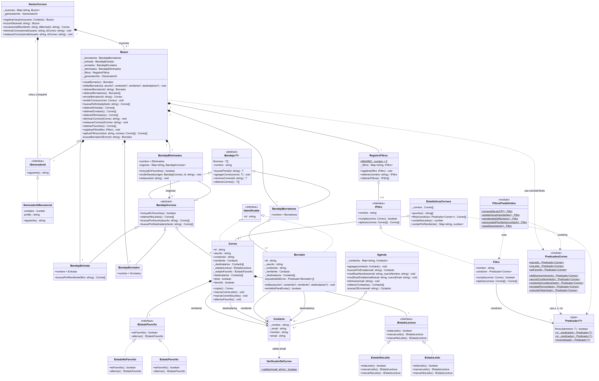

# Sistema Gestor de Correos - Trabajo Práctico Integrador

Nuestro proyecto consiste en un sistema de gestión de correos desarrollado en **TypeScript**, aplicando principios de **Programación Orientada a Objetos (POO)** para el modelado de entidades y **Programación Funcional** para los mecanismos de búsqueda, filtros dinámicos y procesamiento de colecciones.

## Integrantes
* **Diego Gerónimo Escobar**
* **Gabriel Fagundez**

## Tecnologías y Herramientas
* **TypeScript** (Tipado estático y configuración estricta del compilador)
* **Vitest** (Framework para pruebas unitarias automatizadas orientadas a TDD)
* **Git y GitHub** (Control de versiones y GitHub Actions para compilar y correr los tests en cada push)

## Instalación y Configuración

```bash
git clone https://github.com/diegoesscobar/Sistema-de-Gestor-de-Correos.git
npm install
npx vitest run            # corre los tests
npx vitest run --coverage # tests con reporte de cobertura
```

## Diseño

| Clase / módulo | Qué hace | RF |
|---|---|---|
| `Contacto`, `VerificadorDeCorreo` | Nombre y email validado | RF-03 |
| `Agenda` | Alta, consulta, modificación y baja de contactos sin emails repetidos | RF-03 |
| `IIdentificable`, `IGeneradorId`, `GeneradorIdSecuencial` | Contrato de "tener id" y generador de ids que comparten todos los buzones | RF-01 |
| `Correo` | Mensaje con estado de lectura y favorito (patrón State: `EstadoLeido` / `EstadoNoLeido`, `EstadoFavorito` / `EstadoNoFavorito`) | RF-01, RF-08, RF-09 |
| `Borrador` | Correo en redacción, puede estar incompleto | RF-07 |
| `Bandeja<T>` → `BandejaCorreos` → Entrada / Enviados / Eliminados, y `BandejaBorradores` | Herencia de bandejas, cada hija redefine lo suyo | RF-06 |
| `Buzon` | Las bandejas, los borradores y los filtros de un usuario: redactar, enviar, buscar, eliminar y consultar favoritos | RF-02, RF-04, RF-05, RF-06, RF-07, RF-09 |
| `GestorCorreos` | Coordina los buzones: al enviar entrega una copia a cada destinatario y eliminar afecta solo al usuario que elimina | RF-02, RF-06 |
| `Predicado`, `y` / `o` / `no`, `PredicadosCorreo` | Condiciones como funciones que se combinan | RF-04, RF-05 |
| `IFiltro`, `Filtro`, `RegistroFiltros`, `FiltrosPredefinidos` | Filtros con nombre (máximo 5) que no guardan correos | RF-05 |
| `EstadisticasCorreos` | Resúmenes con `map`, `filter` y `reduce` | RF-10 |

### Diagrama de clases UML



### Decisiones principales
* **Cada destinatario recibe su propia copia del correo** (`Correo.copiar()`), así leer, marcar favorito o eliminar en un buzón no afecta a los demás.
* **Polimorfismo en vez de ifs**: cada bandeja dice su `nombre` y si `incluyeEnFavoritos()`. La papelera responde `false`, por eso los eliminados no aparecen en favoritos hasta restaurarlos.
* **La papelera coordina la eliminación**: `BandejaEliminados` saca el correo de su bandeja, recuerda de dónde vino y lo devuelve al restaurar.
* **Inversión de dependencias**: `Buzon` recibe un `IGeneradorId`, y el gestor le pasa el mismo a todos para que los ids no se repitan entre usuarios.
* **Predicados que se combinan**: una condición es una función `Predicado<T>`, y `y` / `o` / `no` reciben predicados y devuelven uno nuevo. Así los filtros se arman reutilizando los que ya existen (`noLeido` es `no(esLeido)`) y no guardan correos: evalúan cada vez que se aplican, por eso reflejan los cambios de leído o favorito al instante.
* **Patrón State para leído y favorito**: cada estado es un objeto que sabe a cuál pasar, así `Correo` no tiene ifs y un estado nuevo se agrega sin tocarlo.
* **Herencia donde hay código compartido, interfaces donde solo hay un contrato**: las bandejas comparten atributos y métodos idénticos, por eso `Bandeja<T>` es una clase abstracta. Los estados solo comparten qué hacen y cada uno lo hace distinto, por eso son interfaces.
* **Copia defensiva**: las colecciones (destinatarios, contactos, correos de una bandeja) se devuelven como copias, para que nadie las modifique desde afuera y se salte las reglas del dominio.
